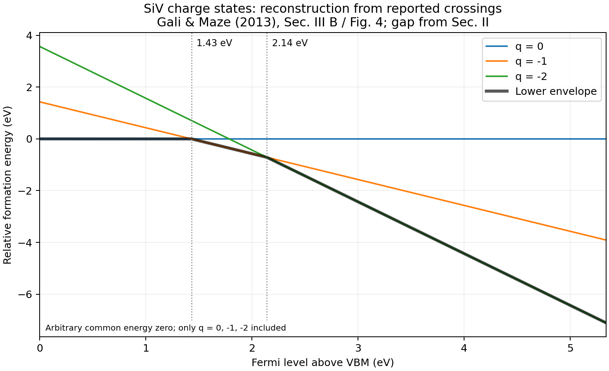

# Exercise 1: which charge state is favored?

**Status:** calculated and checked in the prepared Python study. This is a **relative reconstruction from published transition levels**, covering only q = 0, -1, -2.

## My question

Why does moving the Fermi level change the preferred charge state? I want to derive the answer before treating a formation-energy diagram as a collection of colored lines.

The paper defines formation energies and charge-transition levels in Sec. II, Eqs. (3)-(4), PDF p. 2, and reports the two negative-charge crossings in Sec. III B / Fig. 4, PDF p. 4. The band gap comes from Sec. II. Source: [Gali and Maze, arXiv v2](https://arxiv.org/pdf/1310.2137v2).

## Assumptions and calculation

Put the VBM at Fermi-level zero. For a fixed charge q, collect the Fermi-independent terms into an intercept A_q:

\[
F_q(E_F)=A_q+qE_F.
\]

F and A are energies in eV; E_F is the electron chemical potential in eV above the VBM; q is the integer charge in units of positive elementary charge. Negative q means added electrons. The source reports crossings at 1.43 and 2.14 eV, with a calculated HSE06 band gap of 5.34 eV.

I choose A_0 = 0 **arbitrarily**, then impose equality at the reported crossings:

\[
A_{-1}=1.43\;\mathrm{eV},\qquad
A_{-2}=1.43+2.14=3.57\;\mathrm{eV}.
\]

These intercepts are derived relative values, not the paper's absolute formation energies. The positive-charge line is omitted because its crossing was not supplied numerically in the text. In particular, the near-VBM region below is not a claim that q=0 beats every possible positive state.

The program evaluates 1001 equally spaced Fermi points and inserts the two reported crossings, yielding 1003 distinct rows. It also constructs intervals analytically from every pairwise intersection, keeping only crossings that change the lowest-energy line.

## Result

| Fermi interval above VBM | Lowest relative energy among included states |
|---|---|
| 0 to 1.43 eV | q = 0 |
| 1.43 to 2.14 eV | q = -1 |
| 2.14 to 5.34 eV | q = -2 |

At an interval boundary, the adjacent states are degenerate; the table identifies the minimum in the interval interior. Floating-point output may write 2.1400000000000006 instead of 2.14.

The direct crossing of q=0 and q=-2 occurs at **1.785 eV**, but it is not a stability boundary: q=-1 is lower by **0.355 eV** there. That is a useful warning against labeling every crossing as a charge transition of the stable envelope.

The largest adjacent-crossing residual is about 2.2e-16 eV. Line slopes equal q, shifting every intercept by the same amount leaves stability unchanged, and the nonadjacent crossing is correctly inactive. These are checks of the reconstruction's mathematics, not new agreement with experiment.

## What I understand now

When E_F increases, adding electrons becomes more favorable, so the negative-charge lines decrease more rapidly. The envelope encodes the thermodynamic minimum among the states included. It does not give fractions of centers in each charge state, optical pumping dynamics, conversion rates, or a laser-induced population.

## Remaining question

How would finite temperature, charge neutrality, and a specified reservoir determine actual charge populations? That requires additional inputs beyond these three lines.

## Trace and rerun

- Input: [charge_states.json](../data/charge_states.json).
- Results: [intervals](../runs/first_study/charge_states/stable_charge_intervals.csv), [full curves](../runs/first_study/charge_states/relative_formation_energies.csv), [checks](../runs/first_study/charge_states/metrics.json).
- Input/code snapshots and result hashes: [public provenance](../references/public_provenance.md) ([JSON record](../references/public_provenance.json)). Original execution records remain local and unchanged; the public view explicitly withholds machine paths and commands.
- Run commands: [README](../README.md#reproduce-the-calculations).
