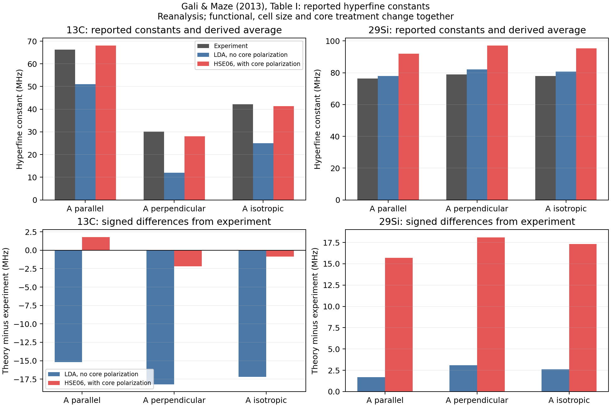

# Exercise 3: what does the hyperfine table actually support?

**Status:** calculated and checked. This is a reanalysis of published principal constants, not a new calculation of electron spin density or an EPR spectrum simulation.

## My question

What does “agreement with the hyperfine measurement” look like when I separate the isotropic and anisotropic contributions? Does the newer theoretical column improve every isotope?

Source: Gali and Maze, Sec. II, Eqs. (1)-(2), PDF p. 2; Sec. III D and Table I, PDF p. 6 ([arXiv v2](https://arxiv.org/pdf/1310.2137v2)). Table I attributes its experimental and older LDA values to the paper's Refs. 15 and 35 respectively. We transcribe those reported numbers; we do not independently remeasure or recompute them.

## Assumptions and calculation

Use an axial, real symmetric tensor with a unit vector u along its parallel principal axis:

\[
A=A_\perp\mathbf1+(A_\parallel-A_\perp)uu^T,
\quad A_{\mathrm{iso}}=\frac{\operatorname{tr}A}{3}
=\frac{A_\parallel+2A_\perp}{3},
\quad T=A-A_{\mathrm{iso}}\mathbf1.
\]

A and T have units MHz. The trace of T must be zero. For our illustrative Cartesian matrices, choose z along the defect [111] axis, use the table's polar angle theta, and set azimuth phi=0. That azimuth is a coordinate choice: Table I does not supply a unique three-dimensional orientation for every tensor. The principal values and isotropic scalar do not depend on this choice.

The source calls the two theoretical columns LDA-nocp and HSE06-cp. We retain their tabulated signs without adding a claim about what a measurement independently establishes about signs. The silicon rows are labeled **29Si**, following Table I and the discussion; the main notes preserve the apparent 28Si wording discrepancy elsewhere in the manuscript.

## Result

The first two numerical columns below are transcribed; the isotropic column is calculated here.

| Isotope | Source method | A parallel (MHz) | A perpendicular (MHz) | A isotropic (MHz) |
|---|---|---:|---:|---:|
| 13C | Experiment | 66.2 | 30.2 | 42.2000 |
| 13C | LDA-nocp | 51.0 | 12.0 | 25.0000 |
| 13C | HSE06-cp | 68.0 | 28.0 | 41.3333 |
| 29Si | Experiment | 76.3 | 78.9 | 78.0333 |
| 29Si | LDA-nocp | 78.0 | 82.0 | 80.6667 |
| 29Si | HSE06-cp | 92.0 | 97.0 | 95.3333 |

The experimental 13C principal-value span is **36.0 MHz**, versus **2.6 MHz** for 29Si. The carbon tensor is substantially more anisotropic in this comparison. Its isotropic value being close is not by itself a complete tensor-agreement test.

For a compact numerical comparison, take the mean absolute principal-value error, counting the repeated perpendicular eigenvalue twice:

\[
\mathrm{MAE}=\frac{|\delta A_\parallel|+2|\delta A_\perp|}{3}.
\]

| Isotope | LDA-nocp MAE (MHz) | HSE06-cp MAE (MHz) |
|---|---:|---:|
| 13C | 17.2000 | 2.0667 |
| 29Si | 2.6333 | 17.3000 |

For carbon, the HSE column has signed errors +1.8 and -2.2 MHz in the parallel/perpendicular components. For silicon, its corresponding errors are +15.7 and +18.1 MHz. The stronger carbon agreement does not carry over to silicon.

The reconstructed tensors recover the expected principal eigenvalues, their isotropic averages, and zero anisotropic traces to floating-point precision. An independent coordinate rotation preserves principal values, isotropic parts, and anisotropic norms. Maximum checked invariant discrepancies are below 3e-14 MHz.

## What I understand now

Hyperfine comparison can support an electronic-structure assignment while also exposing a quantitative mismatch. It is more useful to display the disagreement than summarize the entire table as “good agreement.”

The source emphasizes core polarization, but the theoretical comparison also changes functional and supercell size. This table alone cannot determine how much of either improvement or deterioration is caused specifically by core polarization. It also supplies no error bars for a statistical significance claim.

## Remaining question

What would otherwise matched calculations with and without the core term show for each isotope? Answering that requires additional electronic-structure calculations and an appropriate hyperfine implementation, not another manipulation of this table.

## Trace and rerun

- Input transcription and coordinate choice: [hyperfine.json](../data/hyperfine.json).
- Results: [derived quantities and errors](../runs/first_study/hyperfine/hyperfine_derived_quantities.csv), [illustrative tensor elements](../runs/first_study/hyperfine/illustrative_tensor_elements.csv), [checks](../runs/first_study/hyperfine/metrics.json).
- Input/code snapshots and result hashes: [public provenance](../references/public_provenance.md) ([JSON record](../references/public_provenance.json)). Original execution records remain local and unchanged; the public view explicitly withholds machine paths and commands.
- Run commands: [README](../README.md#reproduce-the-calculations).
