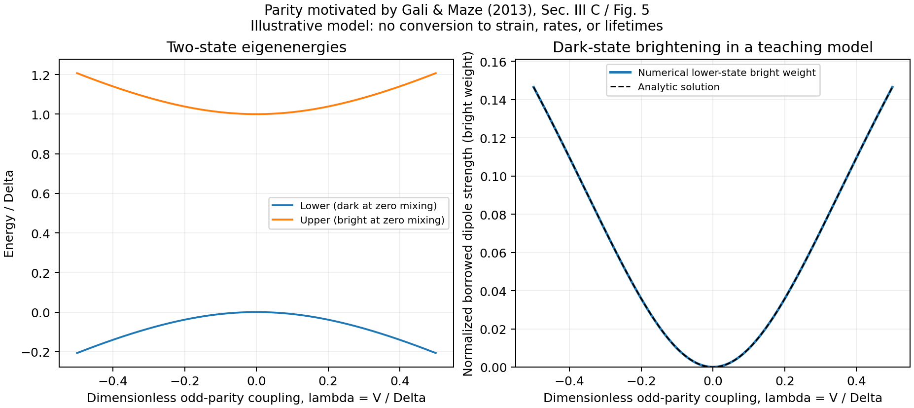

# Exercise 2: how can a same-spin state be dark?

**Status:** calculated and checked. The parity test is a necessary-condition check. The mixing sweep is an explicitly chosen **dimensionless teaching model**, not a fitted SiV Hamiltonian.

## My question

If two states have the same spin, why might the optical transition between them vanish? What would an inversion-breaking coupling change?

The motivation is the inversion-parity argument for shelving states in Gali and Maze, Sec. III C / Fig. 5, PDF pp. 5-6 ([arXiv v2](https://arxiv.org/pdf/1310.2137v2)). The following two-state Hamiltonian is our illustration, not a Hamiltonian or parameter extraction from that paper.

## Assumptions

For the initial parity test, states are exact eigenstates of inversion: g is even (+1), u is odd (-1). The electric-dipole operator is odd. A matrix element is forced to vanish if the product of the three parities is odd.

| Initial | Final | Electric-dipole parity test |
|---|---|---|
| g | g | Forbidden by inversion parity |
| g | u | Not forbidden by parity |
| u | g | Not forbidden by parity |
| u | u | Forbidden by inversion parity |

“Not forbidden by parity” is deliberately weaker than “allowed.” We have not implemented the full D3d representation products, polarization dependence, spin selection, or actual orbital matrix elements.

For the mixing model, hold the even ground state fixed and consider two excited basis states: an even dark state D and an odd bright state B. Choose a zero bare ground-to-D dipole and a unit bare ground-to-B dipole. Let the unperturbed separation be Delta > 0, with an inversion-odd real coupling V:

\[
\frac{H}{\Delta}=\begin{pmatrix}0&\lambda\\\lambda&1\end{pmatrix},
\qquad \lambda=V/\Delta.
\]

The energy zero is at the unperturbed dark excited state; the physical ground-state energy is not part of this matrix. A negative lower eigenvalue relative to that zero is not a negative physical optical excitation energy. Coupling strengths, energy scale, and normalization are teaching choices, with no map to a measured field or strain.

## Calculation

Diagonalize the real symmetric matrix at 401 points from lambda=-0.5 to +0.5. Its energies are

\[
\epsilon_\pm=\frac{1\pm\sqrt{1+4\lambda^2}}{2}.
\]

The lower eigenstate's squared bright coefficient is the normalized borrowed dipole strength:

\[
I_{\mathrm{borrowed}}=\frac12\left(1-\frac{1}{\sqrt{1+4\lambda^2}}\right)
\simeq\lambda^2\quad (|\lambda|\ll1).
\]

Here I is a normalized squared dipole matrix element under our fixed-ground assumption. It omits transition-frequency and population factors, so it is not a complete oscillator strength, emission intensity, radiative rate, or lifetime.

## Result

At zero coupling the lower state is exactly dark. At lambda=+0.5 or -0.5 its bright weight is **0.1464466094**. The sign of the coupling changes the mixing phase but leaves this squared strength unchanged.

| lambda | Borrowed strength | Strength / lambda squared |
|---:|---:|---:|
| 0.01 | 9.997001e-5 | 0.9997001000 |
| 0.001 | 9.999970e-7 | 0.9999970000 |
| 0.0001 | 9.9999997e-9 | 0.9999999700 |

Numerical and analytic strengths agree to about 5.6e-17 over the sweep. Eigenvector residuals and normalization errors are below 5e-16. Zero coupling, coupling reversal, conserved total bright weight, and approach to the quadratic limit all pass their checks.

## What I understand now

An exact symmetry can make a matrix element vanish without changing spin. An explicitly inversion-odd perturbation can mix parity characters, allowing a formerly dark basis state to borrow a dipole amplitude in this model.

I must not turn this into “all strain brightens a dark state.” Homogeneous affine strain can preserve inversion even while changing other symmetries. Whether a real environment supplies the required odd perturbation needs a specific geometry and symmetry argument.

## Remaining question

What microscopic perturbation would produce V for a real SiV center, and would it also modify the ground state, other excited states, phonons, or populations? The two-state curve cannot answer this quantitatively.

## Trace and rerun

- Input and explicit model choices: [parity_mixing.json](../data/parity_mixing.json).
- Results: [parity table](../runs/first_study/parity_mixing/parity_necessary_condition.csv), [sweep](../runs/first_study/parity_mixing/dimensionless_mixing_sweep.csv), [weak limit](../runs/first_study/parity_mixing/weak_mixing_limit.csv), [checks](../runs/first_study/parity_mixing/metrics.json).
- Input/code snapshots and result hashes: [public provenance](../references/public_provenance.md) ([JSON record](../references/public_provenance.json)). Original execution records remain local and unchanged; the public view explicitly withholds machine paths and commands.
- Run commands: [README](../README.md#reproduce-the-calculations).
